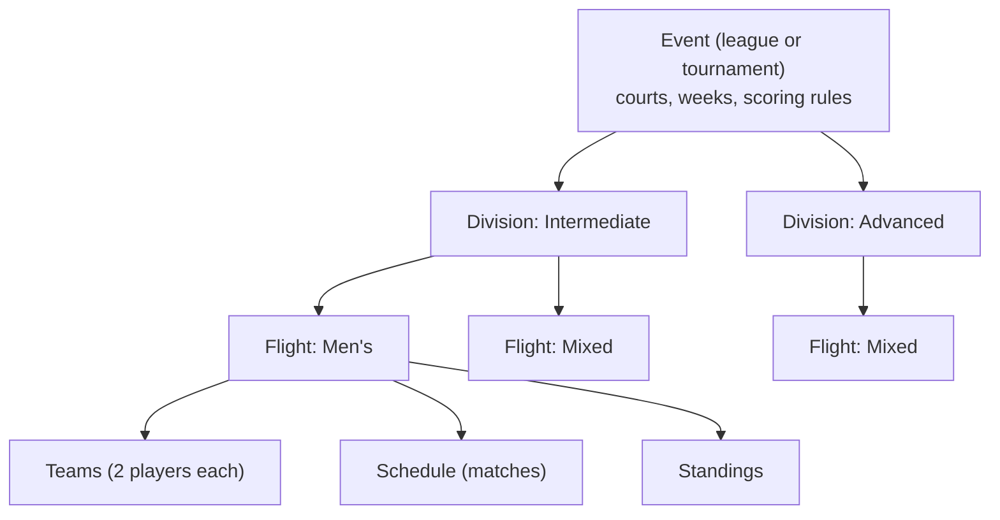
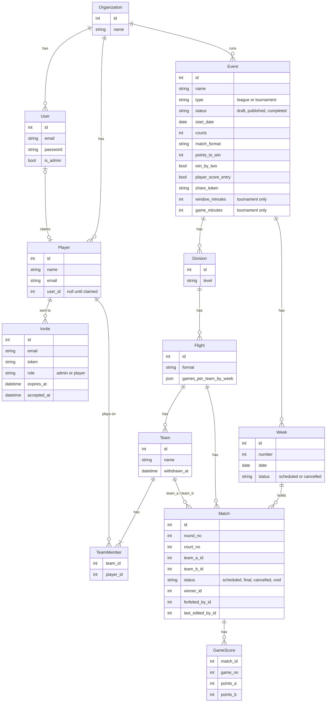

# Pickleball League Manager — PRD, ERD & Scheduling Spec

Nov 17, 2026 · @Luke · revised Nov 18, 2026

## Changes in this revision

| # | Change | Why |
| --- | --- | --- |
| C1 | Scheduler input is now **games per team** each week, not total games per flight | The old input allowed weeks where one team played twice and another not at all |
| C2 | Pass 1 takes whole rotations; the "automatically within 1" claim is removed | It was only true across the season, not within a week |
| C3 | Pass 2 arranges each night to keep a team's games close together; fairness panel shows longest wait | Nothing stopped a team playing Round 1 and Round 6 |
| C4 | Tournament "cap games per team" is the same games-per-team input | One mechanism for leagues and tournaments |
| C5 | Clashing swaps are blocked outright (no "Swap anyway?") | The old text said both |
| C6 | Score validation warns admins instead of blocking them | Timed games can end 9–7 |
| C7 | Standings sort by win percentage, not wins | Games played can differ with odd team counts |
| C8 | Password reset, "Copy invite link", token-based spectator link | Accounts were unusable without real email; `/events/<id>` is guessable |
| C9 | Tonight, score entry and My Games are phone-first | They are used courtside |
| C10 | New "After publish" section and data-model hooks for cancelled weeks, substitutes and late teams | Real use comes after the class demo; no v1 screens for these |
| C11 | ERD and hierarchy diagrams rebuilt as Mermaid | The originals were lost in export |
| C12 | Success measures added | There was no definition of done |

## 1. Overview

A Django web app that lets the Director of Pickleball at Waco Regional set teams, weeks, games per team each week and courts herself, then generates a fair schedule she can tweak before publishing. It replaces Swish, which caps schedules (e.g., 12 games when she needs 16) and gives her no control.

**Problem. **Swish does not allow for optimal customization.

**Solution.** She enters the four controllable inputs: teams, weeks, games per team each week (can differ week to week) and courts. The scheduler builds a balanced schedule, she previews it, swaps anything she doesn't like and publishes. Players log in to see schedules and standings and, when she allows it, enter their own scores.

**North star.** Create a league → see a correct schedule in seconds → swap a game or two → publish. It should feel instant and obviously fair: every team has a near-equal number of games and nobody is on two courts at once.

**Success measures**

- The Director creates and publishes a 4-flight league in under 10 minutes without help.
- No team ever has a night with zero games unless it is that team's bye (odd team counts only).
- Acceptance tests T1–T9 (Section 6) pass.

**Scope by phase**

| Phase | What ships | Notes |
| --- | --- | --- |
| 1 (class v1) | Leagues and tournaments with fixed 2-player teams; scheduler with preview/swap/publish; admin + player accounts; customizable scoring; standings; Tonight view | Setup screens desktop-first; Tonight, score entry and My Games phone-first (used courtside) |
| 2 | Scramble (rotating partners, individual standings); playoff brackets; player self-signup | Data model is ready for Scramble |
| 3 | AI chatbot that fills the setup form from plain English; installable mobile app; notifications | Chatbot calls the same scheduler |

**Out of scope for v1:** game start times (she sets arrival time herself), payments, court reservations, notifications, Scramble, brackets. Also out for v1, but hooked in the data model (Section 7): cancelling or making up a week, substitute players, adding a team after publishing.

## 2. User types and permissions

Three roles: Admins run everything, Players see everything and score their own matches when allowed, and Spectators view a public link without logging in.

| Action | Admin | Player (logged in) | Spectator (public link) |
| --- | --- | --- | --- |
| View schedule, standings, teams | Yes | Yes | Yes |
| Create / edit leagues and tournaments | Yes | No | No |
| Generate, swap and publish schedules | Yes | No | No |
| Enter or edit any score | Yes | No | No |
| Enter a score for own match | Yes | Only when score entry is on for that event | No |
| Add teams and players, send invites | Yes | No | No |
| Mark a team withdrawn (forfeits) | Yes | No | No |
| Add / remove admins | Yes | No | No |

- **Admin accounts:** the director creates the first admin at setup; any admin can add or remove other admins. The last admin can't be removed.
- **Player accounts:** an admin adds a player with name and email; the player gets an invite link and sets a password. Players who never claim the account still appear on teams and schedules.
- **Admin who also plays:** one login can be both. An admin whose email matches a player sees My Games as well as the admin pages.
- **Password reset:** "Forgot password?" on the login page, using Django's built-in reset flow.
- **Spectators:** each published event has a read-only share link built from a long random token (not the event id), so links can't be guessed. No login.
- *Assumption:* one facility (Waco Regional) in v1, but every record hangs off an Organization so more facilities can be added later.

## 3. Information architecture and navigation

An event (league or tournament) holds divisions by level, each division holds flights by format, and each flight is a self-contained competition with its own teams, schedule and standings.

*Rebuilt diagram — the original was lost in export; check it against your source.*



The scheduler works per flight for who-plays-whom, but packs all flights onto the same courts on game night.

**Navigation**

- **Top bar (admin):** My Events · Players · Admins · account menu. **Top bar (player):** My Games · account menu.
- **Event page:** Division and Flight dropdowns at the top, then tabs Schedule | Standings | Teams | Settings (Settings is admin only).
- **Tonight shortcut:** a button on the Schedule tab that jumps to the current week across *all* divisions and flights, grouped by round then court. It is the default view on a game night.
- **Spectators** get the event page through a share link, with no top bar and no edit buttons.

## 4. Core user flows

Six flows cover v1; Flow A is the north star and gets built first.

### Flow A — Create a league and publish its schedule (north star)

**Entry:** My Events → "+ Create".

1. **Basics:** name, type = League, start date, number of weeks, number of courts.
2. **Scoring:** match format (1 game / best of 3 / best of 5), points to win (11 / 15 / 21), win by 2 (on/off), player score entry (on/off).
3. **Divisions and flights:** tick a grid of Level × Format (e.g., Intermediate × Mixed). Each ticked cell becomes a flight.
4. **Teams:** per flight, add teams (name + 2 players). Pick an existing player or add a new one by name and email.
5. **Games plan:** per flight, choose "each team plays every other team: once / twice / custom". Once or twice fills the per-week grid automatically; custom lets her type **games per team** for each week (Week 1: 2, Week 2: 3…). The app works out the total. A live summary shows the result: "16 games · 8 per team · every pair meets 2–3 times".
6. **Generate:** the scheduler builds a draft and opens Schedule Preview.
7. **Preview and swap:** she clicks two games (or two teams in a game) to swap them. Conflicts show inline before she confirms.
8. **Publish:** schedule becomes visible to players and spectators; invites go out to unclaimed players.

**Success:** league page opens on the Schedule tab with a banner "Schedule published · 16 games over 4 weeks".

**Errors:**

- Flight with fewer than 2 teams: "Add at least 2 teams to Intermediate Mixed before generating."
- Long night: "Week 2: each team plays 3 games. On 2 courts that takes 3 rounds." (note, not a block)
- Odd team count: "5 teams: one team sits out each round, so each week one team plays 1 fewer. Byes rotate." (note)
- Empty week: "Round robin once is 3 games per team, but you have 4 weeks. Week 4 has no games — reduce weeks or choose twice." (blocked until fixed)
- Swap creates a clash: "Can't swap: Team Dinkers would play on Court 1 and Court 3 in Round 2." The swap is blocked, with no option to force it. Player clashes across flights are blocked the same way.

**Alternative:** "Regenerate" throws away swaps and rebuilds from the inputs (confirm first: "Regenerating discards your 3 swaps.").

### Flow B — Game night: enter scores

**Entry:** league page → Schedule tab → "Tonight".

1. Tonight lists every flight's games for the current week, grouped by round, then court.
2. Admin (or a player on that match, if score entry is on) taps "Enter score".
3. Score form shows one row per game in the match format (1, 3 or 5 rows), validated against points-to-win and win-by-2.
4. Save → the game card shows the result and standings update.

**Errors:** "Games to 11 must be won by 2 — 11–10 isn't a final score." · "A best-of-3 match ends when one team wins 2 games." · Player not on the match: the button doesn't appear.

**Who gets blocked:** players are held strictly to the rules above. Admins see the same message as a warning with "Save anyway", because a timed game can legitimately end 9–7.

**Two people save at once:** the last save wins and the card shows "last edited by". Once an admin has edited a score, players can no longer change it (A9).

**Alternative:** "Mark forfeit" on a match → choose which team forfeited → the other team gets the win.

### Flow C — Create a tournament (with fit check)

Same wizard as Flow A with type = Tournament. Weeks are replaced by a date, a time window (e.g., 60 min) and an estimated game length (default 15 min, *assumption*). Games plan is a single **games per team** number, defaulting to a full round robin (every team plays every other team once).

**Fit check (live in step 5):**

- Fits: "28 games · 7 rounds on 4 courts · about 1h 45m. Fits your 2-hour window."
- Doesn't fit: "28 games need 7 rounds on 4 courts (\~1h 45m). Your 60-minute window fits 4 rounds. Add courts, extend the window, or lower games per team to 4."

Lowering games per team uses the same input as leagues: the scheduler takes that many rotations of the round robin, so every team still plays the same number of games against different opponents. The message suggests the largest number that fits.

### Flow D — Player claims an account

1. Admin adds the player (name + email) → invite email goes out when the event is published (or via "Send invite").
2. Player opens link → sets password → lands on "My Games": their teams, next match, standings.

**Without email:** every invite also has a "Copy invite link" button, so the admin can text or paste the link. This is how invites work in the class demo, where no real email is sent.

**Forgot password:** login page → "Forgot password?" → reset link by email (admins can also copy a reset link from the Players directory).

**Errors:** "This invite link has expired. Ask your league admin to resend it." · "That email already has an account — log in instead."

### Flow E — Manage admins

Admins page → "Add admin" (email) → they get an invite → appear in the list. "Remove" asks to confirm. **Error:** "You can't remove the last admin."

### Flow F — A team drops out

Teams tab → team → "Withdraw team" → confirm: "Mark Team Dinkers withdrawn? Their 6 remaining games become forfeit wins for their opponents." Played games stay as they are.

*Known unfairness (A6):* teams that already played the withdrawn team keep real scores in their point differential, while later opponents get a forfeit win with no points. The common alternative is to void all of the withdrawn team's results. Confirm with the Director which she wants.

### After publish — what v1 does and doesn't handle

| Situation | v1 |
| --- | --- |
| Move a game to another round or court | Yes — the same swap as in preview, with the same clash checks, on any unplayed game |
| Fix a wrong score | Yes — admin edits it; "last edited by" is kept |
| Team drops out | Yes — Flow F |
| Change teams, weeks or games per team | Only by regenerating, which is blocked once any score is entered |
| Night rained out or cancelled | No screen in v1. Workaround: leave the scores blank. Hook: `Week.status` |
| Substitute player for one night | No screen in v1. Workaround: the team plays under its own name. Hook: per-match player list (same table as Scramble) |
| Add a team mid-season | Not in v1 |

## 5. Page specs

Eleven pages. Every page has four states: loading (skeleton rows), empty, error ("Something went wrong loading this page. Refresh to try again."), and success.

| # | Page | Route | Access |
| --- | --- | --- | --- |
| P1 | Log in / accept invite / reset password | `/login`, `/invite/<token>`, `/password-reset` | Everyone |
| P2 | My Events (admin home) | `/events` | Admin |
| P3 | Create / edit event wizard | `/events/new`, `/events/<id>/setup` | Admin |
| P4 | Schedule Preview (draft) | `/events/<id>/preview` | Admin |
| P5 | Event page — Schedule tab + Tonight | `/events/<id>/schedule` | All (spectators via share link) |
| P6 | Event page — Standings tab | `/events/<id>/standings` | All |
| P7 | Event page — Teams tab | `/events/<id>/teams` | All (edit: admin) |
| P8 | Score entry (modal) | over P5 | Admin; player on match if enabled |
| P9 | Players directory | `/players` | Admin |
| P10 | Admins | `/admins` | Admin |
| P11 | My Games (player home) | `/me` | Player |

Spectators reach P5–P7 at `/s/<share_token>/schedule`, `/standings` and `/teams`. The `/events/<id>/…` routes require a login. P5, P8 and P11 are designed for a phone first.

### P2 — My Events

Table of events, newest first. Columns: name, type, dates, flights, status (Draft / Published / Completed). Row click → P5 (or P4 if draft).

```
[Pickleball Manager]  My Events | Players | Admins        Luke ▾
---------------------------------------------------------------
My Events                                          [+ Create]
Name                     Type        Dates          Status
Spring Tuesday League    League      Mar 3–Mar 24   Published
March Madness Shootout   Tournament  Mar 14         Draft
```

**Empty:** "No events yet. Create your first league or tournament." + Create button.

### P3 — Create event wizard

Five steps with a progress bar; Back/Next; saves as a draft after every step so nothing is lost.

```
Create league   (1 Basics)—(2 Scoring)—(3 Flights)—(4 Teams)—(5 Games plan)
---------------------------------------------------------------
5. Games plan — Intermediate Men's (4 teams)
Each team plays every other team:  ( ) once  ( ) twice  (•) custom
                 Wk1  Wk2  Wk3  Wk4      Total
Games per team   [2]  [2]  [2]  [2]      8 per team
ℹ 16 games · 8 per team · every pair meets 2–3 times
                                   [Back]  [Generate schedule]
```

- Step 3 is a checkbox grid: rows Beginner / Intermediate / Advanced, columns Men's / Women's / Mixed.
- Step 4 has a flight switcher on the left and a team list on the right; "+ Add team" opens an inline row: team name, Player 1, Player 2 (type-ahead from the players directory, or "+ New player").
- Tournament mode swaps weeks for date + window + game length and shows the fit check in step 5.

### P4 — Schedule Preview (draft)

The north-star screen. One week at a time (week tabs across the top); a grid of rounds (rows) × courts (columns). Division and Flight dropdowns filter it; "All flights" shows everything on the courts that night.

```
DRAFT — not visible to players          [Regenerate] [Publish]
Week: [1] 2 3 4        Division [All ▾]  Flight [All ▾]
---------------------------------------------------------------
          Court 1               Court 2
Round 1   Dinkers v Smashers    Lobsters v Kitchen Kings
Round 2   Dinkers v Lobsters    Smashers v Kitchen Kings
---------------------------------------------------------------
Per team this week: Dinkers 2 · Smashers 2 · Lobsters 2 · KK 2
```

- **Swap:** click a game (highlighted), click another game → they trade slots. Click a team name inside a game, then another team name → the teams trade. A conflict shows a red outline and the message from Flow A, and the swap is not saved.
- **Fairness panel** under the grid: games per team (this week and total), times each pair meets, and the longest any team sits between its games that night. Anything uneven, or a sit of more than 1 round, shows in amber.
- **Edge:** if she edits inputs in P3 after swapping, preview warns "Inputs changed — regenerate to apply them."

### P5 — Event page: Schedule tab and Tonight

Top: event name, Division and Flight dropdowns, tabs Schedule | Standings | Teams | Settings (admin only). Schedule lists weeks; each week expands to rounds and courts. "Tonight" (button, default on a game night) jumps to the current week across all flights, grouped by round then court.

```
Spring Tuesday League      Division [Intermediate ▾] Flight [Men's ▾]
Schedule | Standings | Teams | Settings                 [Tonight]
---------------------------------------------------------------
TONIGHT — Week 2 · all flights
Round 1  Court 1  Int Men's   Dinkers 11–7 Smashers        ✓
         Court 2  Int Men's   Lobsters v Kitchen Kings [Enter score]
         Court 3  Adv Mixed   Volley Llamas v Net Gains [Enter score]
```

**Empty (no schedule yet):** "The schedule hasn't been published yet." Spectators see the same page without buttons.

### P6 — Standings tab

One table per flight, sorted by win percentage (wins ÷ games played), then point differential, then head-to-head, then team name (*assumption*). Win percentage rather than wins, because with an odd number of teams games played can differ by one mid-season.

```
Intermediate Men's — after Week 2
#  Team            GP  W  L  PF  PA  Diff
1  Dinkers          4  3  1  41  30  +11
2  Smashers         4  2  2  38  37   +1
```

Forfeit wins count in W but not in PF/PA/Diff. A small "F" marks forfeit results in the team's game list. **Empty:** "Standings appear after the first score is entered."

### P7 — Teams tab

List of teams in the selected flight: name, two players (with "invited" / "active" badge for admins), record. Admin actions: edit team, withdraw team (Flow F). Withdrawn teams show greyed with "Withdrawn".

### P8 — Score entry (modal)

```
Dinkers vs Smashers · Week 2 · Round 1 · Court 1
Best of 3 · games to 11 · win by 2
         Dinkers   Smashers
Game 1   [11]      [ 7]
Game 2   [ 9]      [11]
Game 3   [11]      [ 5]
[Mark forfeit]                         [Cancel] [Save]
```

Game 3 appears only when games are 1–1. For players, Save is disabled until the result is valid. Admins get a warning and "Save anyway" (see Flow B). Edits after saving keep a "last edited by" line. On a phone the modal is full-screen with number-pad inputs.

### P9 — Players directory

Searchable table: name, email, teams, account status (Not invited / Invited / Active). Actions: add player, send/resend invite, copy invite link, copy password-reset link, edit. **Empty:** "No players yet. Players are added when you create teams, or here."

### P10 — Admins

List of admins with "Remove"; "+ Add admin" by email. Last admin's Remove is disabled with a tooltip.

### P11 — My Games (player home)

Cards: "Next up" (event, week, round, court, opponent), my teams with record, link to each event's standings. **Empty:** "You're not on any teams yet."

## 6. Scheduling logic spec

The scheduler is plain, repeatable logic (no AI): the same inputs always produce the same schedule. It works in two passes — first decide **who plays whom** each week, then place those games into **rounds and courts** for the night.

### Inputs

- **Per event:** number of courts; weeks (league) or time window + game length (tournament).
- **Per flight:** its teams; **games per team** for each week (a tournament has one "week": the day itself). "Once" / "twice" round robin just pre-fills these numbers so the season total equals once or twice through every pairing, spread as evenly as possible across weeks with earlier weeks taking any extra.

### Rules

| Type | Rule |
| --- | --- |
| Hard | A team plays at most one game per round. |
| Hard | A player plays at most one game per round, across all flights (one person can be on a Men's and a Mixed team). |
| Hard | At most one game per court per round. |
| Hard | Teams only play teams in their own flight. |
| Guaranteed | Even team count: every team plays exactly the games-per-team number each week. |
| Guaranteed | Odd team count: each week every team plays that number or one fewer (when it has a bye). Nobody gets a second bye before everyone has had one. |
| Guaranteed | Every pair meets k times before any pair meets k+1 times. |
| Soft | Flights sharing courts are interleaved so one flight doesn't finish an hour after another. |
| Soft | A team's games on one night sit close together; the longest sit is shown in the fairness panel. |

"Guaranteed" rules follow directly from Pass 1 below and are checked by tests T7 and T9. They hold for the generated schedule; manual swaps can break them, which is what the fairness panel is for.

### Pass 1 — Who plays whom

1. Build one full round robin per flight using the standard **circle method**: fix one team, rotate the rest one seat each round. With N teams this gives N−1 "rotations" where every team plays exactly once (odd N: add a placeholder "BYE" team, giving N rotations with one team resting each).
2. Keep the rotations in one long list and let it repeat (second time through = the rematches).
3. For each week, take the next *g* **whole rotations** off the list, where *g* is that week's games-per-team number. Carry the position over to the next week. Never split a rotation across weeks.

Because a rotation is exactly one game for every team (or one bye, for odd team counts), taking whole rotations is what makes the "Guaranteed" rules true. Splitting a rotation is what breaks them: the teams whose game fell in the earlier week get nothing the next week. No search or optimisation needed.

Total games in a week = *g* × (number of teams ÷ 2, rounded down).

### Pass 2 — Rounds and courts for the night

Which games are played that night is already fixed by Pass 1. Pass 2 only decides the round and court for each one.

1. Gather every game that night from every flight.
2. **First draft.** Work through the night one rotation at a time: the first rotation of every flight, then the second, and so on. Within a rotation, take games from each flight in turn so flights stay interleaved, with the teams that last played longest ago first. Put each game in the earliest round where it has a free court and none of its 4 players is already playing.
3. **Second draft.** Start again and fill one round at a time. For each free court, pick the game whose team has been waiting longest since its last game. A team that has as many games left as there are rounds left plays now. This draft is dropped if it needs more rounds than the first.
4. **Tidy up each draft.** Look at every way to move one game to a round with a free court, or to trade the rounds of two games, without putting a player in two games at once. Make the change that shortens the waits most, and repeat until nothing helps. If no single game helps, try trading two whole rounds. The longest wait is shortened first, then the next longest. A tidy-up never adds a round.
5. Keep the draft with the shorter waits. In each round, games take the lowest-numbered courts. The number of rounds used is the length of the night; it is never more than the first draft needed.
6. **Tournament fit check:** rounds needed × game length vs the time window. If it doesn't fit, show the Flow C message and suggest the largest games-per-team number that does fit.

### Worked test cases (acceptance tests)

Each case is a unit test: given these inputs, the generated schedule must match the expected result.

**T1 — Her Swish example: 4 teams, 4 weeks, 2 games per team a week (4 games a night), 2 courts.** Teams A, B, C, D. Rotations: R1 = AB, CD · R2 = AC, BD · R3 = AD, BC.

| Week | Games taken | Rounds that night |
| --- | --- | --- |
| 1 | R1 + R2: AB, CD, AC, BD | 2 rounds × 2 courts |
| 2 | R3 + R1: AD, BC, AB, CD | 2 rounds × 2 courts |
| 3 | R2 + R3: AC, BD, AD, BC | 2 rounds × 2 courts |
| 4 | R1 + R2: AB, CD, AC, BD | 2 rounds × 2 courts |

Expected: 16 games; every team plays 2 a night and 8 total; AB, CD, AC, BD meet 3 times, AD and BC meet 2 times. (Swish stops at 12.)

**T2 — Different numbers week to week: 10 teams, Week 1 = 1 game per team, Week 2 = 2 games per team, 5 courts.** Week 1 = rotation 1 (5 games), 1 round. Week 2 = rotations 2 and 3 (10 games), 2 rounds. Expected: every team plays exactly 1 game in Week 1 and exactly 2 in Week 2; no pair has met twice.

**T3 — Tournament that doesn't fit: 8 teams, round robin once (7 games per team), 4 courts, 15-min games, 60-min window.** 28 games; at most 4 games per round (8 teams) → 7 rounds → 105 min. Expected: fit-check failure message suggesting 4 games per team; at 4 games per team → 4 rotations → 16 games → 4 rounds → fits.

**T4 — Odd teams: 5 teams, round robin once, 2 courts.** 10 games over 5 rotations; each rotation has 2 games and 1 bye. Expected: every team gets exactly one bye; 5 rounds.

**T5 — Player in two flights.** Pat is on an Intermediate Men's team and an Intermediate Mixed team playing the same night. Expected: Pat's two games are never in the same round, even if that adds a round.

**T6 — Swap conflict.** In T1 Week 1, swapping AB (Round 1) with BD (Round 2) puts D in two games in Round 1 and A in two games in Round 2 → blocked with the Flow A message. (For all tests, assert these properties rather than exact pairings, since the circle method may order rotations differently.)

**T7 — Nobody gets an empty night.** For every team count from 4 to 12, 4 weeks, and 1, 2 or 3 games per team: with an even count every team plays exactly that number every week; with an odd count every team plays that number or one fewer, and no team has zero games in a week where the number is 2 or more.

**T8 — Short sits: 6 teams, 2 games per team, 2 courts.** 6 games. Expected: the night takes 3 rounds (the minimum), and no team sits out more than 1 round between its two games. The same holds when courts are scarcer: with 2 courts and 2 games per team, 8 teams take 4 rounds, 10 teams take 5 and 12 teams take 6, and still no team sits out more than 1 round. (12 teams, 3 games per team, 2 courts: 9 rounds, at most 1 round's sit. 12 teams, 2 games per team, 1 court: 12 rounds, at most 1 round's sit.)

**T9 — Rotating bye: 5 teams, 5 weeks, 1 game per team.** Each week has 2 games and 1 team sitting out. Expected: each team sits out exactly once over the 5 weeks, and every pair meets exactly once.

**Same inputs, same schedule.** Running the scheduler twice on any of the cases above gives identical output.

## 7. Data model (ERD)

Twelve tables. The scheduler's output is a set of Match rows; standings are calculated from Match and GameScore, never stored, so they can't drift out of sync with the scores.

*Rebuilt diagram — the original was lost in export. Tables and fields are reconstructed from the rest of this document; check them against your source before building.*



**How data flows**

1. Setup writes Event → Division → Flight → Team (+ Player and TeamMember) and one Week per league week.
2. Generate creates Match rows with `status = scheduled` while the Event is `draft`. Swaps just edit `round_no`, `court_no` or the team links on those rows.
3. Publish flips Event to `published`; players and spectators can now see the Matches.
4. Score entry adds GameScore rows, sets `winner` and `status = final` on the Match. A forfeit sets `forfeited_by` and `winner` with no GameScores.
5. Standings = a query over final Matches per Flight: win percentage, then point differential (forfeits excluded from points), then head-to-head, then name. `cancelled` and `void` Matches are ignored.

**Design choices**

- `games_per_team_by_week` is a list on Flight (e.g., `[2, 2, 3, 2]`) rather than its own table. It's simpler, and the custom grid in the wizard edits it directly. A tournament's list has one entry.
- **Hooks for real use, no v1 screens:** `Week.date` and `Week.status` (a cancelled week is skipped by Tonight and standings); `Match.status` values `cancelled` and `void` (void supports the alternative withdrawal policy in A6); `Team.withdrawn_at`. Adding these columns now costs minutes; adding them after a season of live data means a migration.
- `Event.share_token` is a long random string generated at publish; the spectator routes look events up by it.
- Player and User are separate. An admin can add players who never log in; `user` fills in when they accept the invite. This is also what makes self-signup (Phase 2) easy.
- **Scramble path (Phase 2):** add a `MatchSide` table (match, side A/B) with a `MatchSidePlayer` link, and make the team links on Match optional. Leagues keep working, and Scramble games list players instead of teams. The same per-match player list is how substitutes will work: a match records who actually played when that differs from the team's two members.
- Validation to enforce in code: a team has exactly 2 TeamMembers; both teams in a Match belong to the Match's Flight; no team or player twice in the same week and round.

## 8. Assumptions, risks and build checklist

### Assumptions to confirm with the client

Each was a default chosen during planning; check them if you get the chance to talk to her.

| # | Assumption | Why it matters |
| --- | --- | --- |
| A1 | Rounds have no clock times; she announces the start time herself | Keeps start times out of the data model |
| A2 | Default game length for tournaments is 15 minutes | Drives the fit check |
| A3 | Defaults: 1 game per match, to 11, win by 2 | Pre-fills the scoring step |
| A4 | Standings order is win percentage, point differential, head-to-head, then team name | Needed when records tie |
| A5 | Forfeits count as a win but not in points for/against | Stops no-shows from inflating differential |
| A6 | Withdrawn team's remaining games become forfeits; played games stand (alternative: void all of that team's results) | Flow F; the default is uneven for teams that already played them |
| A7 | All flights in an event share the same courts and nights | Pass 2 packs all flights together |
| A8 | Spectators need no login (public share link) | Lowest friction for families and friends |
| A9 | Players may edit their own match score until an admin edits it | Prevents score tug-of-war |
| A10 | She thinks in "games per team each night", not total games for the flight | It is the scheduler's main input (C1) |
| A11 | With an odd number of teams, one team sitting out (or playing one fewer) each week is acceptable | Drives the bye rule in Pass 1 |
| A12 | Admins may save a score that breaks the format rules (e.g., a timed game ending 9–7) | Decides whether validation warns or blocks |
| A13 | Schedule inputs can't change once any score is entered; individual games can still be moved | Keeps regenerate from wiping played results |
| A14 | Her leagues never need a mid-season rainout or substitute screen for the first real season | These are hooks only in v1 |

### Risks

- **v1 carries both leagues and tournaments.** Mitigation: build the league path end to end (create → generate → swap → publish → score → standings) before any tournament work; the tournament is then one wizard variant plus the fit check.
- **Scheduler edge cases eat the timeline.** Mitigation: build Pass 1 + tests T1, T2, T4, T7, T9 in week one, before any UI.
- **Swap UI is the hardest screen.** Mitigation: ship click-to-select-then-click-to-swap (no drag and drop) with HTMX partial reloads.
- **Invites need email.** Mitigation: "Copy invite link" works with no email at all; use Django's console email backend for the class demo and real SMTP before the Director's first season.
- **Not yet decided for real use:** hosting, backups and the facility's time zone for "Tonight". None block the class demo; all three must be settled before live data goes in.

### Build order and checklist

Suggested stack: Django + Django templates + HTMX for in-place updates (swap, score entry) + a simple CSS framework. No separate front end needed.

- [x] Models and migrations for the ERD (Section 7); Django admin registered for quick data entry
- [x] Scheduler module (pure Python, no Django imports) + unit tests T1–T9
- [x] Auth: login, invite token with "Copy invite link", set password, password reset, Admin vs Player permissions
- [x] P2 My Events with empty state
- [x] P3 wizard steps 1–5 for leagues, saving a draft after each step; games-per-team grid with live summary
- [x] P4 Schedule Preview: week tabs, round × court grid, swap with conflict check, fairness panel (including longest sit), Regenerate, Publish
- [x] P5 Schedule tab + Tonight view (phone-first), Division/Flight dropdowns, token share link at `/s/<token>/…`
- [ ] P8 Score entry modal (phone-first) with format validation, admin "Save anyway", and forfeit
- [ ] P6 Standings (computed from scores, sorted by win percentage)
- [ ] P7 Teams tab with withdraw
- [ ] P9 Players directory, P10 Admins, P11 My Games
- [ ] Tournament variant of the wizard with fit check (only after the league path works end to end)
- [x] Seed script: one league (3 divisions × 2 flights, 4–6 teams each, 4 weeks) and one tournament, so the demo never starts empty

### Phase 2–3 hooks already in the design

Scramble (individual entries in matches), playoff brackets (a match can point to the next match), self-signup (Player already links to a login), AI chatbot setup (fills the same wizard fields, calls the same scheduler).
